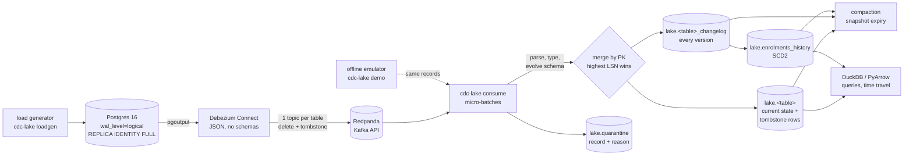

# CDC Lakehouse: Postgres → Debezium → Apache Iceberg


Change data capture from the operational database of a course platform (users, courses,
enrolments, payments) into Apache Iceberg tables. Debezium reads the Postgres write-ahead log
and publishes every insert, update and delete to Kafka (Redpanda); a Python consumer merges
those events into Iceberg with PyIceberg. The merge is ordered by the Postgres LSN, so replays,
duplicates and out-of-order delivery give the same tables. New columns are added to the Iceberg
schema on the fly, type changes go to a quarantine table, enrolments get an SCD2 history, and
old states can be read back through Iceberg snapshots. An offline mode emulates the Debezium
stream, so the whole pipeline runs and is tested without Docker.

**What this project shows**

- CDC semantics done carefully: Debezium envelopes (`c/u/d/r`, `before/after`, `source.lsn`,
  tombstones), highest-LSN-wins merge, soft deletes that block late updates, idempotent replay.
  A test applies a fully shuffled stream with 80 duplicates and gets the exact same tables.
- Iceberg beyond "append Parquet": atomic delete+append commits, schema evolution without
  rewriting files, snapshot time travel, compaction, snapshot expiry and orphan cleanup.
- Data quality you can act on: a type change in the source is refused with a readable reason,
  and reconciliation proves that every difference from the source is explained by quarantine.
- An honest, reproducible end-to-end run: `cdc-lake demo` replays a seeded workload with planted
  problems and checks the lake against the generator's copy of the source database.


## Problem

*"How do we get every change from the production database into the lake within minutes, without
nightly full dumps?"*

A nightly `pg_dump` of the course platform is slow, loads the database, and shows the lake one
state per day: a refund at 10:00 and a re-purchase at 14:00 disappear. Deleted rows silently stay
in the lake. CDC reads the WAL instead, so every committed change arrives once, in commit order
per row, within seconds. The hard part moves to the consumer: Kafka gives at-least-once delivery,
topics are not ordered against each other, the source schema changes, and the lake must stay
correct through all of it.

## Architecture



Iceberg tables live in a SQL catalog (SQLite) with a local warehouse folder; in the Docker stack
the warehouse is a MinIO bucket. Step-by-step code walkthrough:
**[docs/how-it-works.md](docs/how-it-works.md)**. Why each choice was made and what it costs:
**[docs/decisions.md](docs/decisions.md)**.

## Quick start

Needs Python 3.11+. No Docker, no Java, no services.

```bash
python -m venv .venv && source .venv/bin/activate
make install
make demo     # seeded workload -> emulated Debezium -> Iceberg -> checks -> maintenance -> report
```

Then explore the lake:

```bash
cdc-lake --lake data/demo/lake query "SELECT status, count(*) FROM enrolments GROUP BY 1"
cdc-lake --lake data/demo/lake query "SELECT reason, count(*) FROM quarantine GROUP BY 1"
cdc-lake --lake data/demo/lake as-of --business-time 2026-09-02T00:00:00+00:00   # SCD2
cdc-lake --lake data/demo/lake snapshots enrolments
cdc-lake --lake data/demo/lake as-of --table enrolments --snapshot-id <id>       # time travel
```

Apply your own Debezium records (one Kafka record per line, as in `tests/fixtures/`; the JSON
that `rpk topic consume` prints works too):

```bash
cdc-lake generate --out data/stream.jsonl     # or a dump of a real topic
cdc-lake apply data/stream.jsonl
cdc-lake maintain --retain-last 3
```

### Docker stack (not run here)

`docker-compose.yml` starts Postgres 16 (`wal_level=logical`), Redpanda, Debezium Connect 2.7,
MinIO and the consumer. Image tags are pinned to published versions, but **the stack was not
pulled or started in the environment this repo was built in** (no Docker daemon). CI validates
the compose file and builds the consumer image on every push. A separate workflow, `e2e`, runs the
full stack and a smoke test; it is manual on purpose (Actions tab → *e2e* → *Run workflow*, or
`gh workflow run e2e.yml`) so the main CI stays fast and reliable. Locally:

```bash
make e2e    # = scripts/e2e_smoke.sh: up, seed Postgres, register connector, changes, compare
make down
```

## Results

From `make demo` on **synthetic** data (seed 7: 300 users, 24 courses, 3,000 source operations,
batches of 200). Full page with every check: [docs/results.md](docs/results.md).

| Check | Result |
| --- | --- |
| Records applied | 1,642 snapshot + 4,549 streamed (incl. 442 tombstones, 300 redelivered, shuffled in windows of 40) |
| Schema evolution | `courses.level` added mid-stream (a metadata-only commit) |
| Quarantine | 14 events, all `type change: amount_cents expected long` |
| Reconciliation with source | 2,379 rows; 5 payments differ, all 5 explained by quarantine, 0 unexplained |
| Idempotent replay of last 2 batches | 0 state rows, 0 changelog rows written |
| Time travel to the initial-load snapshot | 1,642 rows, 0 differ from the source at that time |
| SCD2 enrolments as of a mid-stream time | 901 rows, 0 differ from the source at that time |
| Maintenance (9 tables) | 18 → 9 live files; 312 → 27 snapshots; 771 → 61 data files on disk |

| Speed (local, single process, shared 2-CPU sandbox) | Value |
| --- | --- |
| Apply throughput, snapshot / streaming | 456 / 142 events/s |
| Freshness at 75 events/s offered, p50 / p95 | 2.8 s / 4.6 s |

The schema change, the type change, the deletes, the disorder and the redelivery were
**planted** by the generator so that every feature has something real to handle. Counts are
reproducible from the seed; timings vary from run to run. Freshness here is "record offered to
the consumer → Iceberg commit" (batch fill + apply); it leaves out Postgres → Debezium → Kafka,
which was not measured. Streaming is slower than the snapshot load because each batch also
reads the stored LSNs, rebuilds SCD2 history and makes copy-on-write deletes; the chart below
shows how much of that cost comes from small files.


## Design decisions (summary)

- **Merge in Python, write with Iceberg transactions.** PyIceberg 0.12 has `upsert`, but no
  "highest LSN wins" and no deletes. The merge decision is a small pure function; the write is
  one delete+append commit per table (copy-on-write).
- **Order by LSN, never by arrival.** Same row → same commit order in the WAL. Equal or lower
  LSN than stored = skip. This one rule gives idempotency, deduplication and disorder tolerance.
- **Soft deletes.** A delete is stored as a row with `_deleted = true`, so a late older update
  cannot bring it back. Readers filter it out.
- **Changelog + rebuilt history.** Every (key, LSN) is kept once in an append-only changelog;
  SCD2 rows for touched keys are rebuilt from it, so a late version lands in the right place.
- **Add columns, refuse type changes.** New columns are metadata-only in Iceberg; a type change
  would corrupt or fail, so the event is quarantined with the reason.
- **Two clocks.** Iceberg snapshots for "what did the lake hold", SCD2 for "what was true in the
  source"; snapshot expiry ends the first, not the second.
- **Offline emulator first.** The same `Lake.apply` serves the emulator and the Kafka consumer, so
  everything except the network is tested in CI.

Full reasoning, costs and alternatives: [docs/decisions.md](docs/decisions.md).

## Project layout

```
src/cdc_lake/
  sources.py      source tables, Iceberg/Arrow schemas, Postgres DDL
  events.py       Debezium envelope parsing (c/u/d/r, tombstones, rpk-style strings)
  coerce.py       JSON value typing, new-column inference, type-change detection
  merge.py        pure merge rules: highest LSN wins, soft deletes, tombstones
  lake.py         Iceberg tables, batch apply, schema evolution, quarantine
  history.py      SCD2 rows from the changelog
  queries.py      current state, snapshot / time travel, SCD2 as-of, DuckDB SQL
  maintenance.py  compaction, snapshot expiry, orphan files, file counts
  loadgen.py      seeded workload, Debezium emulator, delivery simulation
  demo.py         offline end-to-end run, reconciliation, metrics
  report.py       docs/results.md and charts
  live.py         Kafka consumer, Postgres load generator, smoke check (Docker stack)
  config.py, cli.py
connectors/       Debezium Postgres connector config
docker/postgres/  init.sql (kept in sync with sources.py by a test)
tests/            32 tests, 96% coverage; fixtures/*.jsonl in Debezium format
```

## Testing and quality

- **32 tests**: envelope parsing for every op, tombstones and rpk-style strings, and rejection
  reasons; value typing; the pure merge rules; **a fully shuffled stream with duplicates gives
  identical state, changelog, history and quarantine tables**; replay writes nothing and adds no
  snapshot; deletes block late updates; a tombstone alone deletes; add-column without rewriting
  files; quarantine reasons on a type change; SCD2 chaining and the same history from backwards
  delivery; time travel by snapshot, wall time and business time; compaction keeps rows
  identical; expiry removes snapshots and orphan files; a small end-to-end demo with
  reconciliation and a positive control (a row removed behind the pipeline's back is found);
  generator determinism; repo contracts (init.sql, connector settings, pinned images); the CLI.
- **CI** (GitHub Actions): ruff lint and format, mypy, pytest with an 80% coverage gate,
  `docker compose config -q` and a build of the consumer image. The full-stack `e2e` workflow is
  manual (`workflow_dispatch`).
- `live.py` (Kafka, Postgres) is excluded from coverage: it needs the Docker stack.
- `pre-commit install` runs the same checks before each commit.

## What I'd do next

- Run the `e2e` workflow and publish real end-to-end latency (Postgres commit → Iceberg commit).
- Merge-on-read with Iceberg delete files instead of copy-on-write, to make small updates
  cheaper (needs an engine that writes delete files, e.g. Spark or Flink).
- Partition the state tables (e.g. `bucket(id)`) and compact only partitions with many files.
- A `requeue` command that replays fixed quarantined events, and alerts on quarantine growth.
- Store Kafka offsets in the Iceberg snapshot summary for exactly-once without relying on the
  idempotent merge.
- A REST catalog (e.g. Nessie or Polaris) instead of SQLite, so Spark, Trino and DuckDB can read
  the same tables.

Data: all data is synthetic, produced by the seeded generator in `loadgen.py`. No real users or
payments. Debezium, Apache Iceberg, PyIceberg, Redpanda and MinIO are used under their own
open-source licences.
