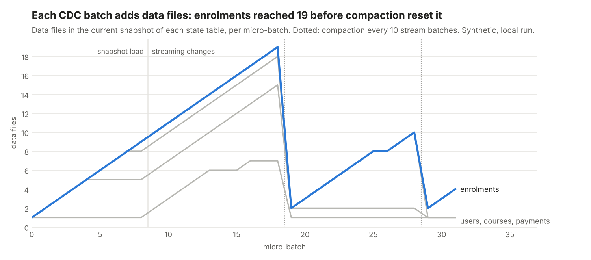
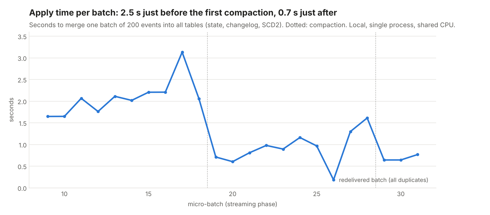

# Results (synthetic data)

Generated by `cdc-lake report` from `data/demo/metrics.json`, written by `cdc-lake demo` (seed 7, 300 users, 24 courses, 3,000 source operations). All data is **synthetic**; the schema change, the type change, the deletes, the shuffling and the redelivery were **planted** by the generator on purpose. Timings are from one local, single-process run on a shared 2-CPU sandbox; they change from run to run, the counts do not.

## Stream

| Item | Value |
| --- | --- |
| Snapshot records (op = r) | 1,642 |
| Change records (c/u/d + tombstones) | 4,249 (442 tombstones) |
| Delivered, incl. redelivered block | 4,549 (+300 duplicates) |
| Shuffle window (beyond Kafka ordering) | 40 records |
| Micro-batches (size 200) | 32 |
| Columns added by schema evolution | courses.level |
| Quarantined records | 14 |

Quarantine reasons:

- `type change: amount_cents expected long`: 14

## Throughput and freshness (local, single process)

| Metric | Value |
| --- | --- |
| Apply throughput, snapshot load | 456.1 events/s |
| Apply throughput, streaming changes | 141.6 events/s |
| Offered rate (simulated producer) | 75 events/s |
| Freshness p50 / p95 / max | 2.79 s / 4.58 s / 5.78 s |

Freshness = time from a record being offered to the consumer until the Iceberg commit that contains it (batch fill time + apply time). It does not include Postgres -> Debezium -> Kafka latency, which was not measured here.

## Correctness checks

| Table | Source rows | Lake rows | Differing keys | Explained by quarantine | Unexplained |
| --- | --- | --- | --- | --- | --- |
| users | 508 | 508 | 0 | 0 | 0 |
| courses | 112 | 112 | 0 | 0 | 0 |
| enrolments | 1,019 | 1,019 | 0 | 0 | 0 |
| payments | 740 | 740 | 5 | 5 | 0 |

- **Idempotent replay:** re-applying the last two batches (400 events) wrote 0 state rows and 0 changelog rows.
- **Time travel:** reading each table at the Iceberg snapshot taken after the initial load returned 1,642 rows; 0 differ from the source database at snapshot time.
- **SCD2 history:** enrolments as of 2026-09-02T02:17:50+00:00 (business time) returned 901 rows against 901 in the source at that moment; 0 differ.
- **Reconciliation:** every key that differs between the lake and the source has a quarantined event. Those rows stay behind until the quarantined events are fixed and replayed; this is the intended cost of refusing a silent type change.

## Maintenance (all 9 tables: state, changelog, history)

| Step | Live data files | Snapshots | Data files on disk |
| --- | --- | --- | --- |
| Before | 18 | 312 | 771 |
| After compaction | 9 | 318 | 774 |
| After expiry (keep last 3) + orphan cleanup | 9 | 27 | 61 |

Row counts after maintenance are unchanged: users 508, courses 112, enrolments 1,019, payments 740.
Compaction adds snapshots (an overwrite is a delete plus an append) and keeps the old files, because time travel still needs them; disk space comes back only when snapshots are expired. The retained snapshots still point at pre-compaction files, which is why more files stay on disk than are live.
